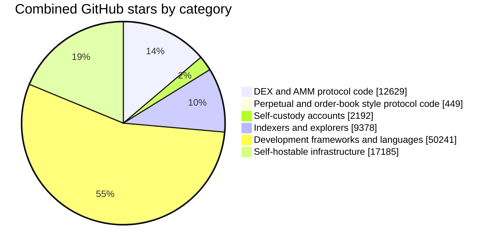

# Awesome Craft Web3 

> A curated list of open-source DEX protocol code, self-custody software, indexers, frameworks and Blockchain infrastructure.

Deploying forked DeFi code needs independent audits and carries real financial risk. This list is not investment, trading or yield advice.

Deploying or forking DeFi and trading protocol code carries real financial risk. Bugs, economic design failures, oracle issues, key compromise and chain reorganizations can cause irreversible loss of funds. Code being public is not an audit. If you deploy contracts that will hold or route value, get an independent security audit, write tests and incident procedures, and do not treat this list as investment, trading or yield advice. Some repositories use BUSL or grant no copyright licence at all; those are not freely forkable for commercial or production use until a change date, grant or conversion applies. Execution clients, chain-specific SDKs and security tools are covered in more depth in the Ethereum, BSC, Solana and Hyperliquid lists.

## Contents

- [Dashboard](#dashboard)
- [DEX and AMM protocol code](#dex-and-amm-protocol-code)
- [Perpetual and order-book style protocol code](#perpetual-and-order-book-style-protocol-code)
- [Self-custody accounts](#self-custody-accounts)
- [Indexers and explorers](#indexers-and-explorers)
- [Development frameworks and languages](#development-frameworks-and-languages)
- [Self-hostable infrastructure](#self-hostable-infrastructure)
- [Related lists](#related-lists)
- [Star history](#star-history)

## Dashboard

<table>
<tr>
<td align="center"><h2>17</h2>listed projects</td>
<td align="center"><h2>6</h2>categories</td>
<td align="center"><h2>92.1k</h2>combined GitHub stars</td>
<td align="center"><h2>29.4k</h2>combined forks</td>
<td align="center"><h2>14/17</h2>pushed in the last 30 days</td>
<td align="center"><h2>7</h2>languages</td>
</tr>
</table>

**FACT** (snapshot taken 2026-11-15, GitHub API): 17 listed projects, 17 of them on GitHub with public repository statistics. Official documentation and other non-GitHub entries are listed but have no stars, forks or push dates.

**ESTIMATE**: 92.1k combined GitHub stars and 29.4k combined forks, summed from those API counts on the snapshot date. Live star badges next to GitHub entries may differ.

### 🏆 Leaderboard

<table>
<tr><th>Rank</th><th>Project</th><th>Kind</th><th align="right">Stars</th><th></th></tr>
<tr><td align="center">🥇</td><td><b>Solidity</b></td><td>Contract language</td><td align="right">25.8k</td><td><code>████████████████████</code></td></tr>
<tr><td align="center">🥈</td><td><b>Kubo</b></td><td>IPFS node</td><td align="right">17.2k</td><td><code>█████████████</code></td></tr>
<tr><td align="center">🥉</td><td><b>Foundry</b></td><td>EVM toolchain</td><td align="right">10.8k</td><td><code>████████</code></td></tr>
<tr><td align="center">4</td><td><b>Hardhat</b></td><td>EVM toolchain</td><td align="right">8.5k</td><td><code>███████</code></td></tr>
<tr><td align="center">5</td><td><b>Vyper</b></td><td>Contract language</td><td align="right">5.2k</td><td><code>████</code></td></tr>
<tr><td align="center">6</td><td><b>Uniswap v3 core</b></td><td>AMM contracts</td><td align="right">5.1k</td><td><code>████</code></td></tr>
<tr><td align="center">7</td><td><b>Blockscout</b></td><td>Block explorer</td><td align="right">4.8k</td><td><code>████</code></td></tr>
<tr><td align="center">8</td><td><b>Uniswap v2 core</b></td><td>AMM contracts</td><td align="right">3.4k</td><td><code>███</code></td></tr>
<tr><td align="center">9</td><td><b>The Graph Node</b></td><td>Indexer</td><td align="right">3.2k</td><td><code>██</code></td></tr>
<tr><td align="center">10</td><td><b>Uniswap v4 core</b></td><td>AMM contracts</td><td align="right">2.6k</td><td><code>██</code></td></tr>
</table>

### Stars by category

### Licences

     

"Custom" or "None" means GitHub could not match a standard SPDX licence, often because of extra terms or an undeclared licence. Read the project licence before you use it commercially.

## DEX and AMM protocol code

- [Balancer v2](https://github.com/balancer/balancer-v2-monorepo) - Smart contracts and related packages for Balancer v2. Check sub-packages for any licence exceptions. 
- [Balancer v3](https://github.com/balancer/balancer-v3-monorepo) - Smart contracts and related packages for Balancer v3. Confirm package-level licence files before redistribution. 
- [Curve contracts](https://github.com/curvefi/curve-contract) - Historical Curve pool contract source. The repository licence states that, except where a specific file header says otherwise, the material is published for informational purposes only and no licence is granted. Do not treat this repository as freely forkable open-source protocol code. 
- [Uniswap v2 core](https://github.com/Uniswap/v2-core) - Core smart contracts for the Uniswap v2 constant-product AMM. 
- [Uniswap v3 core](https://github.com/Uniswap/v3-core) - Core contracts for the Uniswap v3 concentrated-liquidity AMM. Uniswap Labs states that v3 has converted to a GNU GPL after launching under BUSL 1.1. The repository LICENSE file may still show the original BUSL text; re-read the repo and Labs documentation before a commercial fork. 
- [Uniswap v4 core](https://github.com/Uniswap/v4-core) - Core contracts for Uniswap v4. Licence is a mix of BUSL-1.1 and MIT, stated per file. Uniswap Labs documents that BUSL limits commercial or production use until 15 June 2027, after which it converts to MIT, unless an Additional Use Grant applies. v4 is not freely forkable for production use under BUSL until then. 

## Perpetual and order-book style protocol code

- [dYdX v4 chain](https://github.com/dydxprotocol/v4-chain) - The v4 Cosmos-based protocol stack for dYdX. The licence grants AGPL-3.0 subject to applicable law and the v4 Terms of Use at dydx.exchange/legal, and states that rights terminate if those laws are violated in your use. 
- [GMX Synthetics](https://github.com/gmx-io/gmx-synthetics) - Contracts for GMX synthetics. The LICENSE file fetched during research was still BUSL 1.1, with a stated Change Date of 31 August 2026 or an ENS record and a Change License of GPL-2.0-or-later. Confirm the current LICENSE and ENS records before treating a version as GPL or using it in production. 

## Self-custody accounts

- [Safe Smart Account](https://github.com/safe-fndn/safe-smart-account) - Smart-contract account formerly known as Gnosis Safe, used for multi-signature and programmable self-custody. This is account contract source, not a custodial service. Deployment, modules and UI products may have additional terms. 

## Indexers and explorers

- [Blockscout](https://github.com/blockscout/blockscout) - A full-featured block explorer you can self-host. Licence depends on version: official docs say backend v11.0 and frontend v2.8 onward use a source-available licence that requires a commercial licence for paid hosting, RaaS bundling or distributing derivatives for a fee, plus attribution. Older tags up to backend v10.2.0 were GPL-3.0. Do not describe current Blockscout as plain GPL-3.0. 
- [Otterscan](https://github.com/otterscan/otterscan) - A lightweight, self-hostable Ethereum explorer UI, typically pointed at an Erigon or compatible node. 
- [The Graph Node](https://github.com/graphprotocol/graph-node) - The node that indexes chain data into subgraphs you can query. Hosted Graph network services are separate products with their own terms. 

## Development frameworks and languages

- [Foundry](https://github.com/foundry-rs/foundry) - A Rust-based Ethereum development toolkit including forge, cast, anvil and chisel, dual-licensed MIT or Apache-2.0. Deeper Ethereum tooling is listed in Awesome Craft Ethereum. 
- [Hardhat](https://github.com/NomicFoundation/hardhat) - A JavaScript and TypeScript contract development environment. Confirm the licence of any plugin you use; the monorepo says to see each package licence file. 
- [Solidity](https://github.com/ethereum/solidity) - The Solidity compiler, solc. This is a compiler, not a full framework. 
- [Vyper](https://github.com/vyperlang/vyper) - A Python-like contract language and compiler. 

## Self-hostable infrastructure

- [Kubo](https://github.com/ipfs/kubo) - The Go IPFS implementation, used to run an IPFS node. Some older contributions are MIT-only; later contributions are dual MIT and Apache-2.0. Read the repository licence file for the path you ship. 

## Related lists

Other lists in the Awesome Craft series:

- [Awesome Craft](https://github.com/EdisonTKPcom/Awesome-Craft) - A curated list of open-source, self-hostable alternatives to popular SaaS tools.
- [Awesome Craft Agents](https://github.com/EdisonTKPcom/Awesome-Craft-Agents) - A curated list of open-source chat apps, coding agents, self-hosted agent bots, workflow automation and image-generation UIs.
- [Awesome Craft AI](https://github.com/EdisonTKPcom/Awesome-Craft-AI) - A curated list of open-source, self-hostable AI runtimes, servers, Hugging Face libraries and related infrastructure.
- [Awesome Craft BSC](https://github.com/EdisonTKPcom/Awesome-Craft-BSC) - A curated list of verified open-source clients, SDKs, dev tools and protocol code for BNB Smart Chain and opBNB.
- [Awesome Craft CUDA](https://github.com/EdisonTKPcom/Awesome-Craft-CUDA) - A curated list of open-source CUDA learning material, kernel libraries, tooling and portability projects.
- [Awesome Craft DeepSeek](https://github.com/EdisonTKPcom/Awesome-Craft-DeepSeek) - A curated list of official DeepSeek repositories and open-source harnesses, serving engines, eval tools and fine-tuning stacks that work with DeepSeek models.
- [Awesome Craft DevOps](https://github.com/EdisonTKPcom/Awesome-Craft-DevOps) - A curated list of open-source, self-hostable alternatives to popular DevOps and hosting SaaS tools.
- [Awesome Craft DNA](https://github.com/EdisonTKPcom/Awesome-Craft-DNA) - A curated list of open-source tools for DNA, genomics and synthetic biology.
- [Awesome Craft Ethereum](https://github.com/EdisonTKPcom/Awesome-Craft-Ethereum) - A curated list of verified open-source Ethereum clients, SDKs, dev frameworks, wallets and security tools.
- [Awesome Craft EV](https://github.com/EdisonTKPcom/Awesome-Craft-EV) - A curated list of open-source software and hardware for electric vehicles and charging.
- [Awesome Craft Hardware](https://github.com/EdisonTKPcom/Awesome-Craft-Hardware) - A curated list of open-source tools for PCB, FPGA, ASIC and chip design.
- [Awesome Craft Hyperliquid](https://github.com/EdisonTKPcom/Awesome-Craft-Hyperliquid) - A curated list of verified open-source SDKs, node tools, analytics and community libraries for the Hyperliquid ecosystem.
- [Awesome Craft Jarvis](https://github.com/EdisonTKPcom/Awesome-Craft-Jarvis) - A curated list of open-source tools to run a personal JARVIS-style AI assistant locally, including dashboards, agent runtimes, voice, MCP connections and memory.
- [Awesome Craft Malaysia](https://github.com/EdisonTKPcom/Awesome-Craft-Malaysia) - A curated list of open-source tools useful to Malaysian SMEs, with verified MyInvois support called out separately.
- [Awesome Craft Mars](https://github.com/EdisonTKPcom/Awesome-Craft-Mars) - A curated list of open-source tools and open data for Mars missions and settlement planning.
- [Awesome Craft Neuro](https://github.com/EdisonTKPcom/Awesome-Craft-Neuro) - A curated list of open-source tools for brain-computer interfaces, electrophysiology and neurotechnology.
- [Awesome Craft Robotics](https://github.com/EdisonTKPcom/Awesome-Craft-Robotics) - A curated list of open-source robotics software and hardware, including Microduck, Unitree SDKs, open humanoids, arms, simulation and middleware.
- [Awesome Craft Solana](https://github.com/EdisonTKPcom/Awesome-Craft-Solana) - A curated list of verified open-source Solana clients, SDKs, frameworks, explorers and program libraries.
- [Awesome Craft Space](https://github.com/EdisonTKPcom/Awesome-Craft-Space) - A curated list of open-source tools for spaceflight and rockets, covering orbit simulation, telemetry, launch data and more.
- [Awesome Craft Starlink](https://github.com/EdisonTKPcom/Awesome-Craft-Starlink) - A curated list of open-source tools for Starlink and other LEO satellite internet systems.

## Star history

## Contributing

Contributions welcome! Read the [contribution guidelines](contributing.md) first.

If this list is useful, give it a ⭐ so others can find it.

